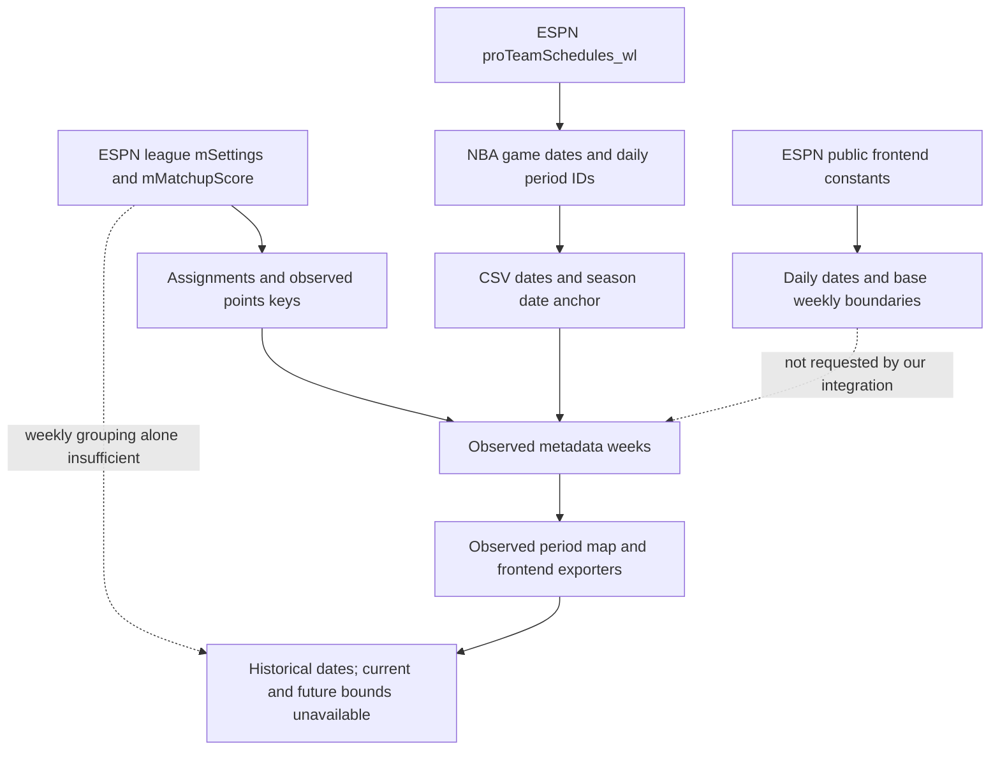

# ESPN fantasy calendar research

Research date: October 27, 2026, America/New_York. Research only; no application, exporter, updater, workflow, canonical data, or deployed artifacts changed.

## A. Executive summary

**Yes. ESPN publishes the missing calendar, including future weeks.** The decisive source is the public configuration consumed by ESPN's own Fantasy Basketball frontend:

```text
config.constants.scoringPeriods[]
  id, startDate, endDate, preSeason, postSeason

config.constants.segments[]                   select league.segmentId
  periodTypes[]                              select scheduleSettings.periodTypeId
    periods[]
      id, scoringPeriodStart, scoringPeriodEnd
```

Join that global calendar to the existing authenticated league response:

```text
settings.scheduleSettings.matchupPeriods[leagueMatchupId]
    → list of base period IDs
    → segments[segmentId].periodTypes[periodTypeId].periods
    → explicit daily scoring-period ranges
    → scoringPeriods date boundaries
```

The second join was missing from the previous investigations. Their warning that `matchupPeriods={"2":[2]}` is **not** a daily boundary remains correct. The conclusion that ESPN does not publish the missing base-week calendar is superseded by the public frontend constants found here.

The standalone experiment reconstructed **all 23 league matchups and all 167 daily periods for 2027**, including the current Week 2, future Weeks 3–20, and playoff Weeks 21–23. Week 18 is explicitly fourteen days in 2027; it was Week 17 in 2024–2026. No seven-day extrapolation was used.

Across 2023–2027, the experiment produced **843 unique inverse rows**, with no conflicts against any existing period-to-week association or player-daily date on either `codex` or fetched `origin/main`. All 6,132 unique games returned by five public pro-team schedule responses had New York dates matching the public daily constants. This is agreement with returned records, not a claim that every NBA fixture is already published.

The installed `espn-api` 0.41.0 does not load or expose these frontend constants. The useful data is mainly **never requested**, rather than fetched and then thrown away by our exporter. Existing exports deliberately retain observed boundaries and suppress unsupported future ranges; that safeguard was appropriate for their inputs.

The smallest reliable future change is to fetch and validate ESPN's public calendar once per season/update, combine it with the league settings already requested, and publish a separate, proven scheduled calendar alongside existing observed metadata. Keep production score/history semantics and the existing date validator unchanged. No additional data provider or Python package is needed.

## B. Existing implementation audit

### Synchronization and inputs

Before investigation: ran status, fetched origin, selected `codex`, pulled with `--ff-only`, and verified local HEAD equals `origin/codex`: `f2e6112f2b143a039c4f5de7d5e86326133faa70`. Fetched main at `afebf1b`. Existing working-tree edits were preserved. Git synchronization required the normal filesystem/network escalation; it completed successfully.

The checked-out branch intentionally contains an older data snapshot than main. Its active 2027 metadata records only period 1. Main records periods 1–8, with 465 daily rows for 2027; live status reports period 8 / matchup 2. Both snapshots were tested rather than treating the old local snapshot as current ESPN state.

| Existing input | What it provides | What it cannot establish alone |
|---|---|---|
| `data/basketballBrawlLeagueData.csv` | Historical Year, Week, pairing, Regular/Playoff/Bye classification and canonical results | No calendar-date columns |
| `data/playerDailyData.csv` | Year, daily Scoring Period and New York game Date | Only roster/player observations; no complete future fantasy week |
| `data/scoringPeriodMatchupMap.csv` | Explicit Year + daily period → Week | Generated from saved observed boundaries; incomplete future coverage and some omitted endpoint off days |
| `data/seasonMetadata.json` | Season limits, dateAnchor, regularWeeks, weeks with observed first/last periods/start/end, assignments and pointsByPeriod | Future assignments need not have points or dates; scheduledWeeks currently empty |
| `frontend/source/season-metadata.json` | Archived fallback for completed seasons | Not an independently authoritative future calendar |
| `data/currentLeague.json` | Current season/week/period, updatedAt, rosters, lineup constraints, allowlisted NBA schedule | NBA schedule supplies games, not fantasy weekly boundaries |
| `frontend/public/data/scoreboard.json` and `matchups/{season}/{week}.json` | Browser states, historical observed ranges, daily dates and remaining-opportunity availability | Deliberately withhold current/future scheduled bounds |

### Trace through the code

1. `playerDailyDataUpdater._record_for_player` derives game dates from wrapper datetimes converted to `America/New_York`. Its repaired timezone behavior must remain unchanged.
2. `nearLiveUpdater.current_calendar` requests `mSettings`, `mMatchupScore`, `mTeam`; takes the union of home/away `pointsByScoringPeriod` keys per matchup; retains archived periods; and adds the live status period to its current matchup. It derives `dateAnchor = Date - scoringPeriod days`. When no daily history exists it uses NBA game dates as anchor evidence. It does not load public frontend constants.
3. `scoreboardCalendar.scheduled_weeks` deliberately returns `[]`, because league scheduleSettings alone was insufficient. Do not simply remove this guard and reinterpret the arrays as days.
4. `playerDailyAggregation.build_scoring_period_map` expands each saved observed first/last boundary inclusively. `scripts/generate_scoring_period_map.py` uses that helper. It does not independently discover a calendar from player stats.
5. `frontend/scripts/refresh_season_metadata.py` also discovers observed boundaries from points keys and CSV anchors. Its `scheduled_weeks` call has no authoritative daily source.
6. `frontend/scripts/generate_scoreboard.observed_dates` validates archived ranges against the canonical period map and date anchor. `project` only exposes those ranges for completed weeks, ignores earlier invalid `scheduledWeeks`, and marks all others unavailable. Enumerated future weeks mostly come from published assignments, not the full settings calendar.
7. `frontend/scripts/generate_matchup_details` dates daily records with anchor + period. Its `remaining_opportunities` already requires `dateRangeKind='scheduled'`, verified bounds, a dated snapshot, NBA coverage, and roster identity before calculating upper bounds.
8. `frontend/scripts/generate_all.py` already invokes these exporters. The normal pipeline could transport a validated calendar without a separate workflow or browser API request.

### Initial data flow and loss points



The loss is not that NBA future games are discarded: the project already retains them. It lacks the **base weekly segmentation** needed to join those games to full fantasy matchups, including zero-game days.

## C. Sources investigated

### 1. Existing league JSON: necessary grouping, insufficient dates

Endpoint:

```text
GET https://lm-api-reads.fantasy.espn.com/apis/v3/games/fba/seasons/{year}/segments/0/leagues/{leagueId}
    ?view=mSettings&view=mMatchupScore&view=mStatus
```

Five seasons inspected, 2023–2027. Credentials came exclusively from `require_espn_credentials()`. No cookies, headers, member records, roster dumps, or complete authenticated responses were saved.

Relevant fields: root `scoringPeriodId`; status `currentMatchupPeriod`, `firstScoringPeriod`, `finalScoringPeriod`, `latestScoringPeriod`; schedule `matchupPeriodId`; side `pointsByScoringPeriod`; scheduleSettings `periodTypeId`, `matchupPeriods`, `matchupPeriodCount`, `matchupPeriodLength`, `playoffMatchupPeriodLength`, `variablePlayoffMatchupPeriodLength`, `playoffTeamCount`.

Current allowlisted excerpt:

```json
{
  "scoringPeriodId": 8,
  "status": {
    "currentMatchupPeriod": 2,
    "firstScoringPeriod": 1,
    "finalScoringPeriod": 167
  },
  "scheduleSettings": {
    "periodTypeId": 2,
    "matchupPeriodCount": 20,
    "matchupPeriodLength": 1,
    "playoffMatchupPeriodLength": 1,
    "variablePlayoffMatchupPeriodLength": false,
    "playoffTeamCount": 6
  }
}
```

`matchupPeriods` contains `1:[1]` through `23:[23]`. Current schedule has 100 regular-season assignments, weeks 1–20; playoff pairings are not yet published there. Observed points membership is week 1 → 1–6, week 2 → 7–8. Future points maps are empty. Side/root schedule key inspection found no hidden start/end dates. Draft availability/date, trade deadline and standings-update timestamps are administrative, not fantasy matchup boundaries.

Cost: one existing league request per active update, so the grouping requires no new request. Coverage: all configured future matchup IDs, even when opponents are unknown. League settings remain authoritative for custom grouping and season limits.

### 2. Actual installed Python library and live objects

Read the source under `/Users/franklinliou/opt/anaconda3/lib/python3.9/site-packages/espn_api/`, including `base_league.py`, `base_settings.py`, `requests/espn_requests.py`, `basketball/league.py`, `team.py`, `matchup.py`, `box_score.py`, and `player.py`.

* `League.fetch_league` initializes base league data, player information, teams/pro schedules, and draft data. The initial views are mTeam/mRoster/mMatchup/mSettings/mStandings. None loads the public UI calendar.
* `BaseSettings.matchup_periods` exposes league grouping; `reg_season_count`, playoff length and team count are parsed. Segment period definitions are absent.
* `League._map_matchup_ids` builds membership from **home-side observed points keys**. Future empty points do not produce calendar entries. It sorts string keys, so it must not be promoted into a general numeric future-calendar API.
* `scoreboard` requests `mMatchup` then selects matchupPeriodId. `box_scores` requests mMatchupScore/mScoreboard with scoringPeriodId and a matchup filter; its defaults consult observed membership. These are score/roster queries, not calendar discovery.
* Team schedules retain opponents and matchup objects, not daily start/end boundaries. `_get_all_pro_schedule` returns NBA proGamesByScoringPeriod. Player schedule parsing uses host-local naive `datetime.fromtimestamp`; the application's New York conversion is necessary.
* No library-retained raw global calendar was found. Raw league data is returned internally; our `current_calendar` retains it as the project-specific `_brawl_raw`. The request object retains credentials, so unrestricted `vars(league)`/request dumps are unsafe and were not printed.

A minimally initialized **live** League object was inspected: `League(fetch_league=False)` followed by the real `BaseLeague._fetch_league` and `_map_matchup_ids`. This exercised the actual parsing without unnecessary player-pool, roster construction, or draft requests. Attribute-name allowlists and period values were retained only. `settings` has the expected 16 parsed attributes; no calendar/segments attribute. `matchup_ids` only contains weeks 1 and 2. Full team/box behavior was inspected in source rather than initiating daily box loops.

### 3. Public season/game API metadata

Tested season root with no view; `kona_game_state` + `kona_game_settings`; `scoringPeriods` as a candidate view; game root with `kona_game_state`; segment root without a view and with game state; season `mNav`.

* Plain season returns `startDate`, `endDate`, `currentScoringPeriod`, and general season identity, not daily/weekly arrays.
* The state/settings combination returns currentScoringPeriod and game settings, including **draftScheduleSettings** start/end dates. Those dates describe the draft window, not scoring days.
* `view=scoringPeriods` does not return a daily calendar; it returns ordinary season metadata. `mNav` returns `{}`. Both tested segment-root requests return 404.
* Current and historical state/settings requests behaved consistently in the three initially sampled seasons 2023, 2026, 2027.

Previous investigations' future scoringPeriodId queries merely echoed the requested ID, while status retained the actual matchup. No new per-day probing was needed: the public frontend implementation gives explicit boundaries directly.

No documented stable fantasy REST JSON calendar endpoint was verified. Do not claim every possible undocumented view is disproven; the important result is a verified public source used by ESPN itself.

### 4. ESPN's public frontend configuration: decisive source

Fetched ESPN's public [Fantasy Basketball Scoreboard](https://fantasy.espn.com/basketball/league/scoreboard) HTML using the existing league route, **without cookies**. Its inline `__NEXT_DATA__ = {...}` bootstrap contains:

```text
props.pageProps.page.config.constants
```

The current bootstrap explicitly declares `constants.seasonConfig=2027`. A `seasonId` query must not be assumed to change those server-rendered constants: ESPN loads historical seasons separately.

Inspected the official versioned [Scoreboard bundle](https://cdn1.espn.net/kona/449ae61ae2f5-1.520/_next/f8bbd749-dc6b-4853-92a4-4ed40e7db182/page/basketball/league/scoreboard.js) and [shared application bundle](https://cdn1.espn.net/kona/449ae61ae2f5-1.520/_next/static/commons/main-c35771d3939c007a8afd.js). The code establishes all three joins:

* League `segment` selects `constants.segments` by segmentId.
* `periods`/`segmentPeriods` select its periodTypes by the league periodTypeId.
* A matchup's list of base IDs selects first/last `scoringPeriodStart`/`scoringPeriodEnd`; those select daily `constants.scoringPeriods` entries for dates.

The code also special-cases period 1's oversized start interval and subtracts a day from basketball endDate for presentation. This independently explains ESPN's future week dropdown dates. The shared bundle includes a New York timezone formatting helper.

Allowlisted example from the actual public 2027 configuration:

```json
{
  "segments": [{
    "id": 0,
    "periodTypes": [{
      "id": 2,
      "periods": [
        {"id": 2, "scoringPeriodStart": 7, "scoringPeriodEnd": 13},
        {"id": 3, "scoringPeriodStart": 14, "scoringPeriodEnd": 20},
        {"id": 4, "scoringPeriodStart": 21, "scoringPeriodEnd": 27},
        {"id": 18, "scoringPeriodStart": 119, "scoringPeriodEnd": 132},
        {"id": 21, "scoringPeriodStart": 147, "scoringPeriodEnd": 153},
        {"id": 23, "scoringPeriodStart": 161, "scoringPeriodEnd": 167}
      ]
    }]
  }],
  "scoringPeriods": [
    {"id": 7, "startDate": 1792998000000, "endDate": 1793084400000, "preSeason": false, "postSeason": false},
    {"id": 13, "startDate": 1793520000000, "endDate": 1793606400000, "preSeason": false, "postSeason": false}
  ]
}
```

Historical constants are separate versioned JavaScript chunks discovered from the shared bundle's actual loader. The loader sets its public path to `assetPrefix + '/_next/webpack/'`; fetching guessed paths without that prefix yielded 403, resolved by reading the loader rather than further guessing. Current-season constants are embedded in the shared bundle and public HTML; all four requested archived chunks returned 200. Exact successful URLs are listed in the evidence appendix.

Availability: public, no league authentication. Coverage verified: 2023–2027, all daily periods and base weeks; historical loader has other years, not fetched here. Cost: one public HTML request for current constants per refresh, cacheable; historical discovery adds public assets once per backfill. Reliability: authoritative ESPN application data, but an **undocumented frontend delivery format**, so parsing, version discovery, season identity, schema and cache validation are essential. Never execute downloaded JavaScript to extract constants; the experiment parsed literal arrays as data.

### 5. NBA schedules: independent date validation, not week discovery

```text
GET https://lm-api-reads.fantasy.espn.com/apis/v3/games/fba/seasons/{year}?view=proTeamSchedules_wl
settings.proTeams[].proGamesByScoringPeriod[period][]
  id, date, homeProTeamId, awayProTeamId, scoringPeriodId, statsOfficial
```

`date` is a game-start Unix epoch in milliseconds. Games appear under both teams and were deduplicated by public game ID. Five bounded requests were sufficient:

| Season | Unique returned games checked | Distinct periods with games | Date disagreements |
|---|---:|---:|---:|
| 2023 | 1,231 | 164 | 0 |
| 2024 | 1,232 | 160 | 0 |
| 2025 | 1,235 | 163 | 0 |
| 2026 | 1,234 | 164 | 0 |
| 2027 | 1,200 | 156 | 0 |

These counts describe returned schedule records, including games beyond this league's final fantasy period; they are not official completed-game counts. `statsOfficial` and publication/coverage must still be respected. Off days have no game records; hence this response alone cannot recover weekly boundaries.

### 6. Alternatives and request discipline

No new provider is necessary. Public NBA/team schedules from ESPN or another provider could validate game dates but cannot independently establish fantasy matchup boundaries, custom grouping or fantasy playoffs. Their marginal request/maintenance cost is unjustified when ESPN's own fantasy constants contain the answer.

Only read-only GET requests were used. Work was bounded to five seasons, league calendar/settings views, one minimal live object, public schedule responses and exact public frontend assets. No per-player/day scraping, authenticated browser automation, live updater, ESPN write, or external sharing of private league data occurred. General web searches supplied leads only; findings above rely on inspected local source and direct ESPN responses/assets.

## D. Verified mapping results

Every row below joins the actual 2027 public weekly definition to actual league grouping and daily endDate labels. `first`/`last` are daily scoring periods, not base week IDs. Dates are inclusive display dates in America/New_York. Weeks 21–23 are configured fantasy playoffs even though future opponents are not yet published.

| Season | Matchup week | First daily period | Last daily period | Start date | End date | Days | Evidence |
|---|---:|---:|---:|---|---|---:|---|
| 2027 | 1 (regular) | 1 | 6 | 2026-10-20 | 2026-10-25 | 6 | ESPN segment 0 / type 2 / base 1 + daily endDate + league grouping |
| 2027 | 2 (regular) | 7 | 13 | 2026-10-26 | 2026-11-01 | 7 | ESPN segment 0 / type 2 / base 2 + daily endDate + league grouping |
| 2027 | 3 (regular) | 14 | 20 | 2026-11-02 | 2026-11-08 | 7 | ESPN segment 0 / type 2 / base 3 + daily endDate + league grouping |
| 2027 | 4 (regular) | 21 | 27 | 2026-11-09 | 2026-11-15 | 7 | ESPN segment 0 / type 2 / base 4 + daily endDate + league grouping |
| 2027 | 5 (regular) | 28 | 34 | 2026-11-16 | 2026-11-22 | 7 | ESPN segment 0 / type 2 / base 5 + daily endDate + league grouping |
| 2027 | 6 (regular) | 35 | 41 | 2026-11-23 | 2026-11-29 | 7 | ESPN segment 0 / type 2 / base 6 + daily endDate + league grouping |
| 2027 | 7 (regular) | 42 | 48 | 2026-11-30 | 2026-12-06 | 7 | ESPN segment 0 / type 2 / base 7 + daily endDate + league grouping |
| 2027 | 8 (regular) | 49 | 55 | 2026-12-07 | 2026-12-13 | 7 | ESPN segment 0 / type 2 / base 8 + daily endDate + league grouping |
| 2027 | 9 (regular) | 56 | 62 | 2026-12-14 | 2026-12-20 | 7 | ESPN segment 0 / type 2 / base 9 + daily endDate + league grouping |
| 2027 | 10 (regular) | 63 | 69 | 2026-12-21 | 2026-12-27 | 7 | ESPN segment 0 / type 2 / base 10 + daily endDate + league grouping |
| 2027 | 11 (regular) | 70 | 76 | 2026-12-28 | 2027-01-03 | 7 | ESPN segment 0 / type 2 / base 11 + daily endDate + league grouping |
| 2027 | 12 (regular) | 77 | 83 | 2027-01-04 | 2027-01-10 | 7 | ESPN segment 0 / type 2 / base 12 + daily endDate + league grouping |
| 2027 | 13 (regular) | 84 | 90 | 2027-01-11 | 2027-01-17 | 7 | ESPN segment 0 / type 2 / base 13 + daily endDate + league grouping |
| 2027 | 14 (regular) | 91 | 97 | 2027-01-18 | 2027-01-24 | 7 | ESPN segment 0 / type 2 / base 14 + daily endDate + league grouping |
| 2027 | 15 (regular) | 98 | 104 | 2027-01-25 | 2027-01-31 | 7 | ESPN segment 0 / type 2 / base 15 + daily endDate + league grouping |
| 2027 | 16 (regular) | 105 | 111 | 2027-02-01 | 2027-02-07 | 7 | ESPN segment 0 / type 2 / base 16 + daily endDate + league grouping |
| 2027 | 17 (regular) | 112 | 118 | 2027-02-08 | 2027-02-14 | 7 | ESPN segment 0 / type 2 / base 17 + daily endDate + league grouping |
| 2027 | 18 (regular) | 119 | 132 | 2027-02-15 | 2027-02-28 | 14 | ESPN segment 0 / type 2 / base 18 + daily endDate + league grouping |
| 2027 | 19 (regular) | 133 | 139 | 2027-03-01 | 2027-03-07 | 7 | ESPN segment 0 / type 2 / base 19 + daily endDate + league grouping |
| 2027 | 20 (regular) | 140 | 146 | 2027-03-08 | 2027-03-14 | 7 | ESPN segment 0 / type 2 / base 20 + daily endDate + league grouping |
| 2027 | 21 (playoff) | 147 | 153 | 2027-03-15 | 2027-03-21 | 7 | ESPN segment 0 / type 2 / base 21 + daily endDate + league grouping |
| 2027 | 22 (playoff) | 154 | 160 | 2027-03-22 | 2027-03-28 | 7 | ESPN segment 0 / type 2 / base 22 + daily endDate + league grouping |
| 2027 | 23 (playoff) | 161 | 167 | 2027-03-29 | 2027-04-04 | 7 | ESPN segment 0 / type 2 / base 23 + daily endDate + league grouping |

Inverse examples from the 167-row 2027 lookup:

| Season | Daily period | Calendar date | League matchup |
|---|---:|---|---:|
| 2027 | 1 | 2026-10-20 | 1 |
| 2027 | 6 | 2026-10-25 | 1 |
| 2027 | 7 | 2026-10-26 | 2 |
| 2027 | 8 | 2026-10-27 | 2 |
| 2027 | 13 | 2026-11-01 | 2 |
| 2027 | 14 | 2026-11-02 | 3 |
| 2027 | 119 | 2027-02-15 | 18 |
| 2027 | 132 | 2027-02-28 | 18 |
| 2027 | 147 | 2027-03-15 | 21 |
| 2027 | 167 | 2027-04-04 | 23 |

### Historical agreement and investigated differences

| Season | Complete league daily periods | Archived player rows checked per branch | Existing map rows checked per branch | Conflicting dates / week associations |
|---|---:|---:|---:|---:|
| 2023 | 175 | 10,412 | 173 | 0 |
| 2024 | 167 | 10,338 | 163 | 0 |
| 2025 | 167 | 9,801 | 167 | 0 |
| 2026 | 167 | 9,281 | 167 | 0 |
| 2027 | 167 | codex 8; main 465 | codex 1; main 8 | 0 |

All 39,832 archived daily rows agree. All 670 existing archived map rows agree. Every observed daily points key from all five fresh league responses also maps to the same matchup. Inverse keys are unique and each league range covers periods 1 through its configured final period without gaps or overlap.

**Existing observed endpoints differ from scheduled endpoints in five completed matchups.** These are explained omissions, not contradictory mappings:

| Season/week | Existing observed range | Published scheduled range | Missing off-day periods |
|---|---|---|---|
| 2023/1 | 2–7, Oct 18–23 | 1–7, Oct 17–23 | 1 |
| 2023/24 | 170–175, Apr 4–9 | 169–175, Apr 3–9 | 169 |
| 2024/6 | 35–40, Nov 27–Dec 2 | 35–41, Nov 27–Dec 3 | 41 |
| 2024/7 | 42–46, Dec 4–8 | 42–48, Dec 4–10 | 47, 48 |
| 2024/9 | 56–61, Dec 18–23 | 56–62, Dec 18–24 | 62 |

For each of these six daily periods, both the live league points-key union and the public pro-team schedule contain no observations/games. The experiment checked that explicitly. Thus observation-derived metadata understandably omits their endpoints. Do not silently rewrite that historical metadata: store scheduled and observed ranges as separate evidence kinds. Some no-game dates already inside an observed interval are included by existing expansion; absence of games never invalidates the scheduled calendar.

2027's old local Week 1 metadata only covers period 1 because that snapshot is old; live completed week 1 covers 1–6. This is snapshot age, not a calendar conflict.

## E. Edge cases and timestamp semantics

### Daily dates are not raw startDate truncations

The constants use Unix milliseconds for **fantasy period rollover boundaries**, not NBA tipoff times. For 2027, ordinary boundaries are 03:00 New York; UTC changes from 07:00 to 08:00 with DST. A source interval can include hours after midnight on the next civil date.

Verified display-date rule for normal daily periods, matching ESPN's end-date-minus-day presentation and every tested canonical/game date:

```python
datetime.fromtimestamp(period['endDate'] / 1000,
                       ZoneInfo('America/New_York')).date() - timedelta(days=1)
```

Subtract a **calendar day after explicit timezone conversion**. Do not use host-local conversion, fixed 24-hour arithmetic across DST, or `endDate - 1 millisecond` (which would still be the next civil date at about 03:00). Keep the precise rollover timestamps separately if needed for current-period logic.

Period 1's startDate is especially misleading: 2027 period 1 begins **May 27, 2026 at 03:00 NY** and ends October 21 at 03:00. Its scoring/display date is **October 20**, not May 27. ESPN's own matchup-range helper special-cases this period. Preseason id 0 and the global postseason sentinel also span long intervals and must not become ordinary daily rows.

Tested conversion under host zones UTC, New York, Los Angeles and Tokyo: identical labels for first period, current week, autumn DST, spring DST, and the league's terminal period. Period 12 ends November 1 at 03:00 EST; its label remains October 31. Period 146 labels March 14 even though its UTC offset has changed. All 6,132 public game timestamps also agree after explicit New York conversion; this includes UTC dates differing from New York game dates.

Game timestamps and fantasy rollover timestamps have different meanings. The ESPN-provided scoring-period ID remains the membership key. A future postponed or after-midnight game disagreement should cause explicit validation/fallback, not automatic reassignment by guessed dates. Preserve the existing per-season/date conflict invariant and the repaired daily updater.

### Week lengths and season boundaries

* 2027 opening week: six days, October 20–25. 2023's first week includes a scheduled no-game Monday.
* 2027 Week 18: February 15–28, fourteen days. 2026 Week 17: February 9–22, fourteen days. Never copy a previous season's week numbering or compute `week * 7`.
* Cross-year week 11 in 2027 spans December 28, 2026–January 3, 2027.
* Global 2027 constants include ordinary periods through 174 and a postseason sentinel 175. **This league ends at period 167.** Do not export the additional global week 24 or sentinel week 25 as league matchups.
* 2023 league settings include 21 regular weeks and 24 total; 2024–2027 include 20 regular and 23 total. Select by actual league grouping/limits, not maximum global period ID.

### Fantasy playoffs, byes and multi-week matches

2027 fantasy playoffs are March 15–April 4: weeks 21, 22, 23, each seven days. The global daily `postSeason` boolean does **not** identify this league's fantasy playoffs; the league regular-week count and grouping do. This league's playoff length is one base period and variable length is false. No current 2027 playoff pairing is implied by knowing its dates.

Completed historical settings and results confirm the league's playoff periods; a first-round bye changes participation, not the calendar. Proposed UI must retain `Bye` and unknown-opponent states without fabricating a matchup or score.

ESPN's source code explicitly combines multiple base period IDs for a league matchup. The appropriate algorithm expands their actual daily ranges and verifies contiguity rather than assuming one/two calendar weeks. **A different real multi-week league configuration was not queried**, so support for that configuration is evidenced by source, not a new live league experiment. A base period can itself be fourteen days during All-Star break; combining base periods can therefore exceed fourteen days.

## F. Recommended solution and presentation

### Ranked data approaches

1. **Validated public ESPN constants + existing league settings.** Retrieve public current-season bootstrap without credentials; verify `seasonConfig`, segment, periodType and schema; allowlist daily/weekly fields; combine with existing grouping; validate against canonical observations and NBA dates. Cache the last validated per-season calendar. Do this server-side during the updater, never in the visitor's browser. No dependency or workflow redesign needed.
2. **Retained per-season calendar sourced from the same official constants.** Useful archival/offline fallback, with source URL, season, retrieval time and digest. Historical modules can be discovered from the public loader once; do not hardcode current asset hashes as a permanent API. Reject stale wrong-season configuration and require an explicit audited process for genuine calendar revisions.
3. **Observed metadata + verified date anchor**, the existing fallback. Preserve it if discovery/validation fails; it supports dated observations but must not certify complete future ranges. NBA-only calendars or fixed-seven-day extrapolation are inadequate replacements.

The public bootstrap has a formatting/asset-version maintenance risk, but it is the strongest verified machine-readable source found. Parse the embedded JSON assignment with a decoder, not JavaScript evaluation. Historical literal parsing also must not execute remote code. If an equivalent supported JSON endpoint is later verified, it can replace discovery without changing the normalized schema.

### User-facing recommendations — not implemented

| Surface | Proposed presentation | Required evidence |
|---|---|---|
| Scoreboard week heading | `Week 2 · Oct 26 – Nov 1, 2026` | Scheduled range; include both years when crossing a year |
| Individual matchup | Same inclusive dates; `Playoffs` or `Bye` separately | League grouping and participation remain independent |
| Daily chart X-axis | `Oct 26`, `Oct 27`; full date in tooltip | Inverse day lookup; null for unknown scoring, no invented scores |
| Daily table | `Monday, October 26`; optional `Today` / `Tomorrow` | Verified date, New York civil-day comparison, dated score snapshot |
| Remaining games | `Today`, `Tomorrow`, or `Oct 29`, plus tipoff timezone | NBA game start + verified matchup inclusion; started/unconfirmed exclusion retained |
| Future navigation | Publish all 23 dated weeks; unknown playoff opponents shown as pending | Calendar may exist before pairings; no predicted scores |

Keep numeric scoring-period IDs internal to JSON keys, joins and diagnostics. Do not parse date-only ISO strings through browser UTC midnight and then display in local time, which can shift a day. Relative labels should use an explicitly chosen league timezone (New York), with absolute dates always available. `Today` describes the civil date; it must not silently substitute the snapshot's current scoring-period ID, especially between midnight and ESPN's rollover.

If a validated source is unavailable, an unsupported segment/type appears, the season is unpublished, a commissioner changes grouping, or source comparisons disagree, show `Dates unavailable` with the known week identity. Display partial observations as observations, never complete ranges. Future opponents and complete NBA fixture coverage can remain unavailable even when the fantasy date range is known.

## G. Proposed implementation plan — no implementation performed

1. Introduce a small isolated reader/normalizer (for example `espnFantasyCalendar.py`) with explicit HTTP timeout, bounded retrieval, no auth logging, public-only requests, allowlisted output, cache provenance and strict season/schema checks. Keep a tiny sanitized fixture for all three layers: league grouping, base periods, daily boundaries.
2. Extend `scoreboardCalendar.py` to accept **actual global period definitions** in addition to league settings. Retain its current fail-closed behavior when definitions are absent. Produce complete `scheduledWeeks` and a daily lookup separately from observed `weeks`. Never overload the legacy incorrectly derived scheduled payload without validation/versioning.
3. Call the reader once from `nearLiveUpdater.current_calendar`/its integration. Validate before publishing via existing staged/atomic JSON writes. Align retained provenance with `dated_snapshot`: do not change updatedAt merely because retrieval occurred. Distinguish a failed auxiliary calendar request from corrupt candidate data; retain prior valid calendar only when season/settings fingerprint still matches. No unbounded historical fetch during regular updates.
4. Update `frontend/scripts/refresh_season_metadata.py` only if this live/manual metadata path remains supported, using the same reader. Avoid duplicate extraction logic. Keep `playerDailyAggregation`'s canonical observed mapping unchanged initially; regression-check every existing association against scheduled data. Decide separately whether an additive future map belongs in a new metadata field or separate reference file. No historical totals, eligibility or scoring edits are needed.
5. Update `frontend/scripts/generate_scoreboard.py` to select validated scheduled ranges and enumerate configured future/playoff week IDs even without pairings; preserve observed fallback and score logic. Update `generate_matchup_details.py` to consume the same calendar for dates and remaining bounds, keeping unknown/partial scores and completed-game handling intact. Future current-roster counts must be labeled as current-roster upper bounds, not predictions.
6. In a separate UI change, update `frontend/src/ScoreboardPage.jsx`, `frontend/src/MatchupDetail.jsx`, and date helpers/validation in `frontend/src/scoreboard-data.js` as necessary. Read the existing design system first. No layout redesign is needed.
7. Add targeted cases to `tests/test_scoreboard_calendar.py`, `tests/test_near_live.py`, `tests/test_daily_dates.py`, `frontend/scripts/test_scoreboard_calendar_real.py`, `frontend/scripts/test_matchup_details.py` and relevant existing frontend tests. Run existing export/build pipeline against a disposable source snapshot. Only then permit the scheduled pipeline to publish the new metadata.

Required regression cases: complete 2027 23-week/167-day coverage; all 39,832 archived daily dates and 670 existing map associations; no-game endpoints; first-period offseason start; All-Star week moving between seasons; leap dates; autumn/spring DST and host-zone independence; cross-year labels; byes; playoff settings without pairings; multi-base grouping including an extended base week; wrong season/segment/type; missing/sentinel periods; noncontiguous or overlapping membership; rejected schema/retrieval and safe cache fallback; actual status membership; unchanged snapshots and atomic failure.

Remaining-start impact: this calendar removes the missing-boundary blocker, but does not prove all other inputs sufficient. Retain snapshot time, NBA coverage, player NBA identity, IR exclusion, started-game exclusion and one-player/one-slot matching. Team presence alone is not proof that every future NBA fixture is published (for example unsettled tournament scheduling); incomplete game coverage must still suppress claims of complete totals. Roster locks, injuries, future transactions and game limits remain separate limitations. A date-source change must not alter score reconciliation or claim projections are solved.

## H. Unresolved questions and practical limits

* No stable, documented REST JSON equivalent of the public frontend constants was found. Public HTML/asset discovery needs conservative maintenance and fallback. This is an implementation consideration, not a missing-calendar blocker.
* Alternative real league configurations (multiple base periods per matchup, variable-length playoffs, nonzero segment) were not queried. The source supports the join structure; live verification here is this league across five seasons.
* Future opponents/brackets are not yet known for 2027 playoffs. Their **date ranges** are established.
* ESPN may revise season calendars or postpone games. Current evidence cannot guarantee immutability; validation and provenance should detect meaningful revisions.
* Future NBA game availability is separate from fantasy calendar coverage. All returned records agree, but publication completeness cannot be inferred from this experiment's record counts.
* Date-only display semantics and precise 03:00 rollover semantics should remain distinct. Offseason sentinel periods must not be treated as active scoring dates.

No remaining blocker to designing the normalized calendar implementation. The user explicitly requested research only, so that implementation, its UI changes, and deployment remain for a separate task.

## Evidence and reproduction appendix

Disposable files are under `/private/tmp/brawl-calendar-research/` and are **not committed**:

* `probe.py`: initial bounded endpoint investigation; only sanitized league calendar fields are retained.
* `experiment.py`: offline literal parsing and join proof. It never evaluates ESPN JavaScript. Reads branch data and fetched main with `git show`; never writes repository datasets.
* `results.json`, `inverse.csv`: all five seasons' mapping results and 843 inverse rows.
* `league-calendar-{year}.json`: allowlisted period/settings/membership evidence, without members or scores.
* `calendar-constants-{year}.json`: public global daily and weekly definitions.
* `public-nba-{year}.json`, `nba-checks.json`: public game ID/time/period comparison evidence.

Reproduce the offline mapping after those disposable public inputs are present:

```bash
python /private/tmp/brawl-calendar-research/experiment.py
```

The proof selects the segment/type by IDs, expands each league matchup's base-period definitions, bounds them by the league's first/final scoring period, gets each daily display date from its explicit New York end boundary minus one civil day, and writes `(Year, Scoring Period, Week, Date)`. Separate assertions confirmed 843 unique contiguous keys, zero CSV/live-membership disagreements, 6,132 public-game date agreements, and current period 8 → week 2. Host-zone checks passed in four zones. The eight existing focused tests passed: `python -m unittest tests.test_daily_dates tests.test_scoreboard_calendar -q`. No frontend build was necessary because this task changes only the research report. `git diff --check` passed, and final status confirmed the report is the only newly added repository artifact.

Exact public archived asset URLs, discovered from the inspected loader (versioned assets may eventually expire):

* [2023 public calendar bundle](https://cdn1.espn.net/kona/449ae61ae2f5-1.520/_next/webpack/chunks/modules_api_lm_seasons_fba_2023_0c725312896be60e19c64a9eba29e24b-b186692e6cebb09a271e.js)
* [2024 public calendar bundle](https://cdn1.espn.net/kona/449ae61ae2f5-1.520/_next/webpack/chunks/modules_api_lm_seasons_fba_2024_b72d6a806c136c9f1e034164e35d9f62-be3d576725553b9be67e.js)
* [2025 public calendar bundle](https://cdn1.espn.net/kona/449ae61ae2f5-1.520/_next/webpack/chunks/modules_api_lm_seasons_fba_2025_0746407caf9ac53e8e9e743cac295c8b-1eb59f118e11b72c89d8.js)
* [2026 public calendar bundle](https://cdn1.espn.net/kona/449ae61ae2f5-1.520/_next/webpack/chunks/modules_api_lm_seasons_fba_2026_3be81645dbe39bf3c7b1b1f60069885b-673d503edc494fcaef4b.js)

SHA-256 digests of the **normalized public arrays used in the experiment**, not raw HTTP bodies:

* 2023: `f172bfd0bfcb1692df77426526db3c94cadd173ab9a98e4cb40fbfec7a4b1c49`
* 2024: `9217531ac9f47e904e90d320f1749422c9d0fe5109a948de64640f1aaf3dc00f`
* 2025: `834835ae0540e9680e2e5b724602c17ffd19c8cf0d3daebc67ed5af4505d8a22`
* 2026: `be23aa00f005a9d4854672b57a39062eaed16f9d83f6ea426479e9e8628ec454`
* 2027: `28ed224b85fb857df73958e73ad77a4256c3347eca0b5d4fb65694ea186f4098`

### Scope verification

Only this Markdown report was added to the repository. No production implementation, canonical data write, commit, push, workflow run or deployment was performed. Existing local edits remain in place. The temporary experiments used the existing credentials helper and retained no credential values or authenticated response dumps.
